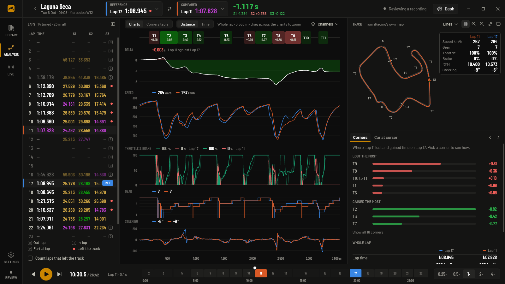
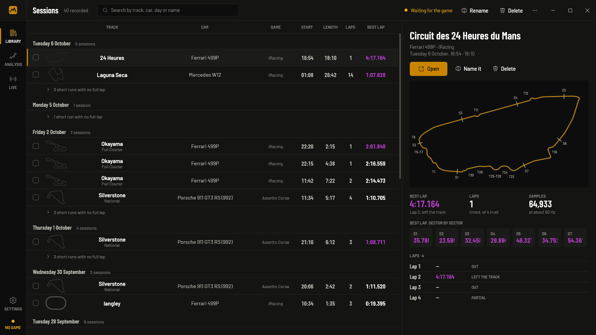
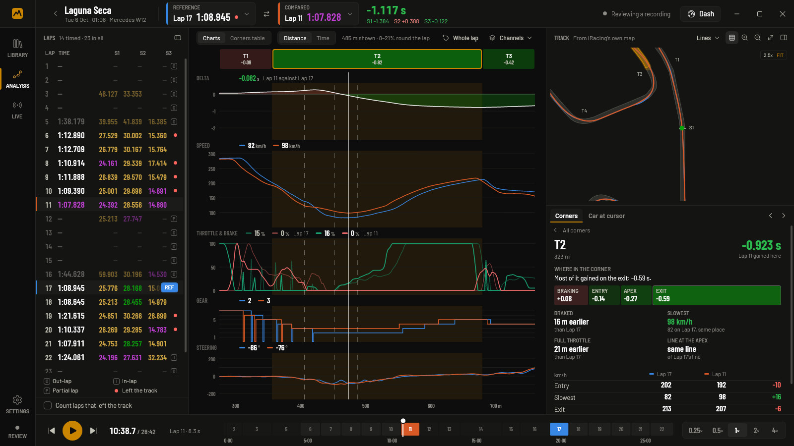
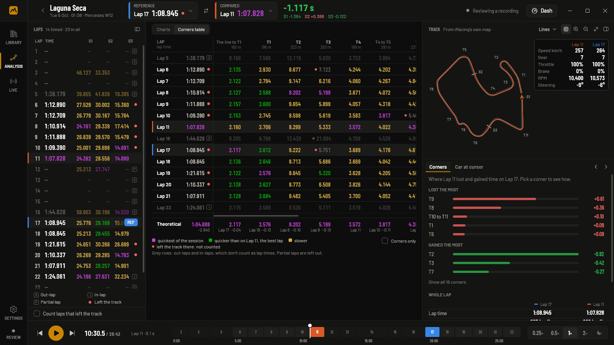

# Telemetry

Telemetry records your laps in Assetto Corsa and iRacing and shows where you
gain and lose time against another lap, corner by corner. It runs on Windows.

## Download

Get **Telemetry.exe** from the [latest release](https://github.com/GalloFrancesco04/Telemetry-releases/releases/latest) and run it. You don't need to install anything first. The .NET runtime is inside the executable.

Windows says the publisher is unrecognised because the executable isn't code signed. Choose **More info**, then **Run anyway**.

The app tells you when a newer version is out and updates itself from Settings. Each release also carries `Telemetry.exe.sha256`, so you can check a download yourself.

## Games

- **Assetto Corsa**, the original by Kunos. Assetto Corsa Competizione and Assetto Corsa EVO are not supported.
- **iRacing.** The app reads only the telemetry that iRacing's SDK publishes for outside programs. It never touches the sim's process, its window or its files.

Start the app before or after the game. It finds whichever game is on track and starts recording when the car moves. You don't need to set anything up in the game.

## Recording

Every session is recorded at about 95 samples a second from Assetto Corsa and 60 from iRacing (iRacing's own rate). The app records speed, pedals, gear, steering, RPM, lap and sector times, position on track, tyres, fuel, g-forces, suspension, aids and brake bias. A session in which the car never moved is not kept.

The library lists sessions by day, with the circuit, car, length, laps and best lap. You can search, rename and delete them. Short runs with no full lap fold into a single row.

## Reviewing a session

Open a session and pick two laps: a reference and the lap to compare with it. The reference can come from another session on the same circuit.

- **Lap list.** Lap and sector times use timing-screen colours: purple for the session best, green for quicker than the reference, yellow for slower. Out-laps, in-laps, partial laps and laps that left the track are marked and don't count as lap times. Settings can count laps that left the track.
- **Charts.** You get delta, speed, throttle and brake, gear and steering, plotted against distance or time, plus any other recorded channel you choose. Corner names run along the top. Drag across a chart to zoom into that stretch.
- **Track map.** Both laps' lines are drawn on the circuit: blue for the reference, orange for the compared lap. The map can also colour a lap by speed, throttle, brake or delta. The map is drawn as geometry, so it stays sharp however far you zoom.
- **Corners.** A ranked list of where the lap lost and gained time. Picking a corner zooms the charts to it. It shows the time in four phases (braking, entry, apex, exit), and where you braked and went back to full throttle compared with the reference. It also shows the minimum speed and how far your line was from the reference line.
- **Replay.** Play the session back at 0.25× to 4×, or scrub through it. The reference lap's car follows on the map as a ghost.

The corners table puts every lap against every corner, so you can see which corners you drive the same way every lap and which you don't. Its last row adds up your best time through each stretch into a theoretical best lap.

## Track maps

The circuit is drawn from the game's own data. Your driving only places it on the map, so a line that leaves the road is drawn off the road.

- **Assetto Corsa:** the road edges, kerbs and corner names come from the track's files in your Assetto Corsa install. A track without corner names gets numbered turns.
- **iRacing:** iRacing's published map of the circuit, with corner names from [lovely-track-data](https://github.com/Lovely-Sim-Racing/lovely-track-data).

The circuit is saved with the recording, so a session still opens with its map on a PC without the game.

## While driving

- **Live** opens by itself when you go on track. It shows a timing screen, live traces and the map, with your best lap as a ghost car.
- **Dash:** a fullscreen dash with revs, speed, gear, delta to your best lap, lap and sector times, inputs and tyres. **M** moves it to another monitor, **Esc** closes it.
- **Overlay:** a strip of telemetry over the game, with cells you can rearrange. The game has to run borderless windowed, because nothing can draw over exclusive fullscreen.
- **Shift lights:** they light up and flash at the car's shift points. They can sit in the overlay or in a window of their own.
- **Remote dash:** the same dash in a browser on a phone or tablet on your home network. It has no password, so turn it on only on a network you trust.

## Your data

Recordings and settings live in `%LocalAppData%\Telemetry`, outside the executable. A new version replaces the old one without losing anything. Settings has a button that opens the folder.

The app is in English and Italian. Pick the language in Settings.

Settings → About shows the version you're on. Include it when you report a bug.

## Copyright

© 2026 Francesco Gallo. All rights reserved. This repository only hosts the release downloads. No part of the app may be copied, modified or redistributed without permission.

Corner names for iRacing circuits come from [lovely-track-data](https://github.com/Lovely-Sim-Racing/lovely-track-data) by Lovely Sim Racing, licensed under CC BY-NC-SA 4.0.
