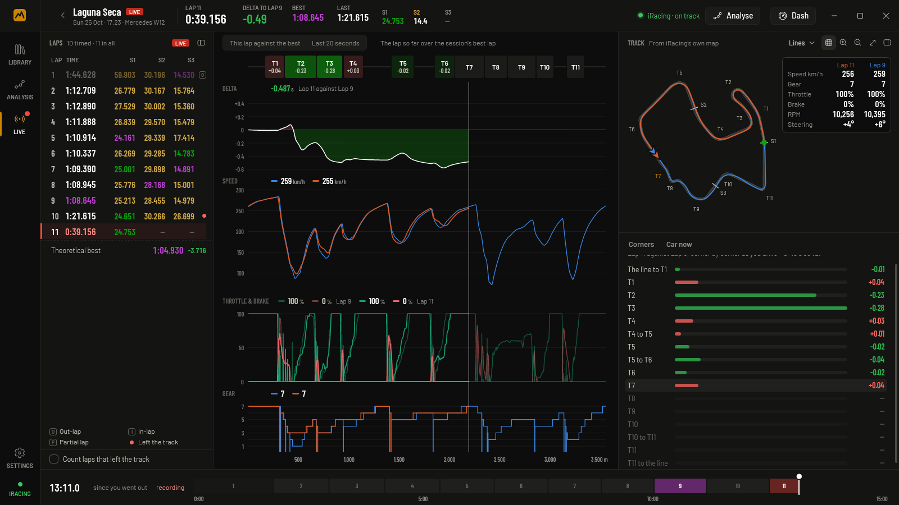
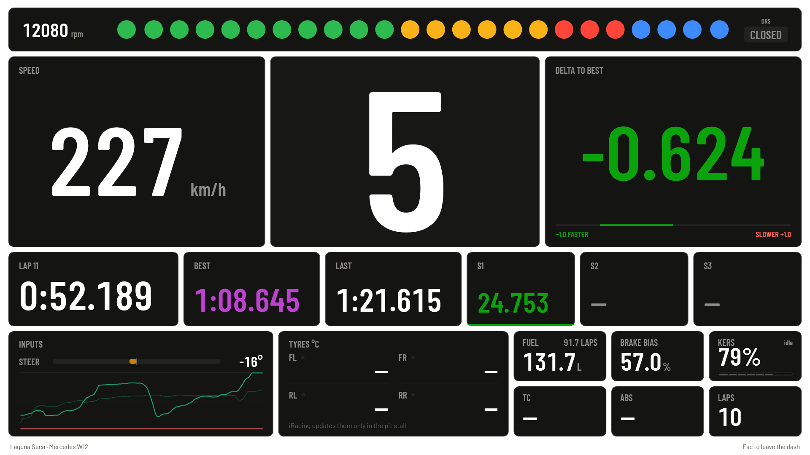
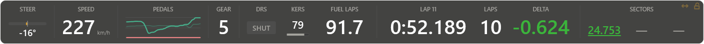

# Telemetry

**Find the time you're losing, corner by corner.** Telemetry records every lap you drive in Assetto Corsa and iRacing, then lays two laps side by side and shows where you gained and lost time, all on your own PC.

**[Download the latest release](https://github.com/GalloFrancesco04/Telemetry-releases/releases/latest)** · [Quick start](#quick-start) · [Games](#games) · [Reviewing a session](#reviewing-a-session) · [While driving](#while-driving) · [Your data](#your-data)

- **Records on its own.** Start it before or after the game; it picks up whichever game is on track and records when the car moves.
- **Compares any two laps,** from the same session or another day, with the time won and lost in every corner.
- **Works while you drive** too: a live timing screen, a fullscreen dash, an overlay over the game and shift lights.
- **No account, nothing to install.** One executable, and your laps never leave your PC.

## Quick start

1. Download **Telemetry.exe** from the [latest release](https://github.com/GalloFrancesco04/Telemetry-releases/releases/latest) and run it. The .NET runtime is inside it, so there's nothing else to install.
2. Windows says the publisher is unrecognised, because the executable isn't code signed. Choose **More info**, then **Run anyway**.
3. Drive. Live opens when you go on track, and the session is in the library when you leave.
4. Open the session, pick two laps, and see where the time went.

The app tells you when a newer version is out, shows what's new in it, and updates itself from Settings. Each release also carries `Telemetry.exe.sha256`, so you can check a download yourself.

## Games

| Game | How it's read | Set up in the game |
|---|---|---|
| **Assetto Corsa** (the original, by Kunos) | Its shared memory, about 95 samples a second | Nothing |
| **iRacing** | The telemetry its SDK publishes for outside programs, 60 samples a second | Nothing |

The app never touches iRacing's process, its window or its files: it only reads what the SDK publishes. Assetto Corsa Competizione and Assetto Corsa EVO are not supported.

## Recording and the library

Every session keeps speed, pedals, gear, steering, RPM, lap and sector times, position on track, tyres, fuel, g-forces, suspension, aids and brake bias. A session in which the car never moved isn't kept.

The library lists sessions by day, with circuit, car, length, laps and best lap.

- Search, rename and delete sessions, and give each one a note ("new tyres", "setup v3") to tell them apart later.
- Short runs with no full lap fold into one row, out of the way.
- A session's preview shows its map, best lap and sectors, and your best lap in that car on that circuit, session by session, so you can see whether you're getting quicker.

## Reviewing a session

Open a session and pick two laps: a reference and the lap to compare with it. The reference can come from another session on the same circuit.

- **Lap list.** Lap and sector times in timing-screen colours: purple for the session best, green for quicker than the reference, yellow for slower. Out-laps, in-laps, partial laps and laps that left the track are marked and don't count as lap times (Settings can count laps that left the track).
- **Charts.** Delta, speed, throttle and brake, gear and steering against distance or time, plus any other recorded channel. Corners run along the top, shaded by the time won or lost in each. Drag across a chart to zoom into that stretch.
- **Track map.** Both laps' lines on the circuit, blue for the reference and orange for the compared lap, or one lap coloured by speed, throttle, brake or delta. It's drawn as geometry, so it stays sharp however far you zoom.
- **Corners.** Where the lap lost and gained the most. Pick a corner and the charts zoom to it, with its time split into braking, entry, apex and exit, where you braked and got back on the throttle against the reference, your slowest speed and how far your line was from the reference line.
- **Replay.** Play the session back at 0.25× to 4×, or scrub through it, with the reference lap following on the map as a ghost.

The **corners table** puts every lap against every corner. Its theoretical best row adds your best time through each stretch into one lap, and its consistency row shows how far your typical lap is from your quickest in each corner: the corners where practice pays.

## Track maps

The circuit is drawn from the game's own data. Your driving only places it, so a line that leaves the road is drawn off the road.

- **Assetto Corsa:** road edges, kerbs and corner names from the track's files in your Assetto Corsa install. A track without corner names gets numbered turns.
- **iRacing:** iRacing's published map of the circuit, with corner names from [lovely-track-data](https://github.com/Lovely-Sim-Racing/lovely-track-data).

The circuit is saved with the recording, so a session still opens with its map on a PC without the game.

## While driving

**Live** opens by itself when you go on track: a timing screen, the lap so far against your best on the same charts as the review screen, the map with your best lap as a ghost, and the time won or lost in each corner as you drive it. The delta can be to this session's best lap or to your best ever in that car on that circuit. When you leave the track, Live sums the session up: best lap, theoretical best, how it compares with your best ever, and your most and least consistent corners.

**Dash.** A fullscreen dash with revs, speed, gear, delta to your best lap, lap and sector times, inputs, tyres, and fuel with the laps it's good for. **M** moves it to another monitor, **Esc** closes it.

**Overlay.** A strip of telemetry over the game, with cells you can pick and rearrange. Run the game borderless windowed: nothing can draw over exclusive fullscreen.

**Shift lights** light up and flash at the car's shift points, in the overlay or in a window of their own.

**Remote dash.** The same dash in a browser on a phone or tablet on your home network. It has no password, so turn it on only on a network you trust.

## Your data

- Recordings and settings live in `%LocalAppData%\Telemetry`, outside the executable, so a new version replaces the old one without losing anything. Settings has a button that opens the folder.
- There's no account and nothing is uploaded. The app goes online only to check GitHub for a newer version and its notes, and to fetch iRacing's published track maps.
- The app is in English and Italian; pick the language in Settings.

## Good to know

- Windows only, 64-bit.
- iRacing updates tyre temperatures only in the pit stall, so the dash shows them there.
- The overlay and the shift-light window need the game in borderless windowed mode.
- Settings → About shows the version you're on. Include it when you report a bug.

## Copyright

© 2026 Francesco Gallo. All rights reserved. This repository only hosts the release downloads. No part of the app may be copied, modified or redistributed without permission.

Corner names for iRacing circuits come from [lovely-track-data](https://github.com/Lovely-Sim-Racing/lovely-track-data) by Lovely Sim Racing, licensed under CC BY-NC-SA 4.0.
